# Azure Data Factory Medallion Pipeline: Airline Bookings

An end-to-end data engineering project on Azure. It ingests airline data from **three different kinds of sources** (an on-premises file server, a public GitHub URL, and Azure SQL Database), lands it in **ADLS Gen2** using a **bronze / silver / gold** layout, cleans it with **ADF Mapping Data Flows** (Spark under the hood), and produces two business views: top airlines and top flights by total sales.

> Editable diagrams (draw.io) live in [`docs/diagrams`](docs/diagrams). Open them at [app.diagrams.net](https://app.diagrams.net).

## What this project demonstrates

| Skill | Where |
|---|---|
| Hybrid ingestion with a **self-hosted integration runtime** | `Onprem_Ingestion` |
| REST / HTTP ingestion (Web activity + Copy) | `API_Ingestion` |
| **Incremental loading with a watermark** from Azure SQL DB | `Azuresql_to_datalake` |
| Metadata-driven, parameterized copy (ForEach + dynamic datasets) | `Onprem_Ingestion` |
| Pipeline orchestration | `parentPipeline` |
| Mapping Data Flows: derive, cast, filter, select, join, aggregate, window rank | `datatransformation`, `DataServing` |
| Upsert into **Delta** tables via alter row | silver layer |
| Medallion architecture on ADLS Gen2 | `bronze`, `silver`, `gold`, `monitor` containers |

<table>
  <tr>
    <th align="center">Architecture</th>
  </tr>
  <tr>
    <td align="center">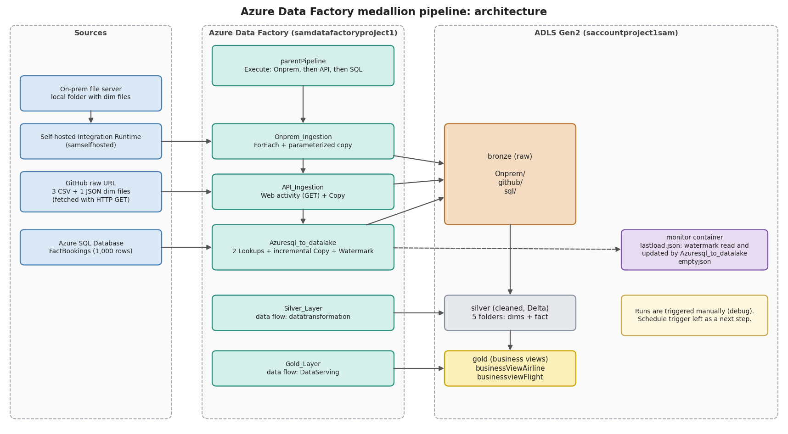</td>
  </tr>
</table>

## Data

All data is synthetic and sized for a demo.

| Table | Rows | Source | Format | Notes |
|---|---|---|---|---|
| `DimAirline` | 10 | on-prem file server | CSV | `airline_id, airline_name, country` |
| `DimFlight` | 10 | on-prem file server | CSV | `flight_id, flight_number, departure_time, arrival_time` |
| `DimPassenger` | 10 | on-prem file server | CSV | `passenger_id, full_name, gender, age, country` |
| `DimAirport` | 10 | on-prem file server | JSON | `airport_id, airport_name, city, country` |
| `FactBookings` | 1,000 | Azure SQL Database | table | loaded in two batches (1 to 499, then 500 to 1000) to prove incremental ingestion |

The dimension files are fetched from GitHub with an HTTP GET and staged in a local folder, which then acts as the source for the self-hosted integration runtime. Sample copies are in [`data/source`](data/source). The fact table DDL and inserts are in [`sql/`](sql): `fact_bookings_batch1.sql` (table + ids 1 to 499), `fact_bookings_batch2.sql` (ids 500 to 1000, dated July 2025 so they fall after the first watermark), and `fact_bookings_full.sql` (all 1,000 rows with their original dates).

## Azure resources

Everything sits in one resource group, `ADF_project_sam`:

| Resource | Type |
|---|---|
| `samdatafactoryproject1` | Data Factory (V2) |
| `saccountproject1sam` | Storage account (ADLS Gen2) |
| `dbsqlserverproject1` / `azuresqlDBproject1` | SQL server / SQL database |
| `samselfhosted` | Self-hosted integration runtime (on a local machine) |

<table>
  <tr>
    <th align="center">Resource groups</th>
  </tr>
  <tr>
    <td align="center">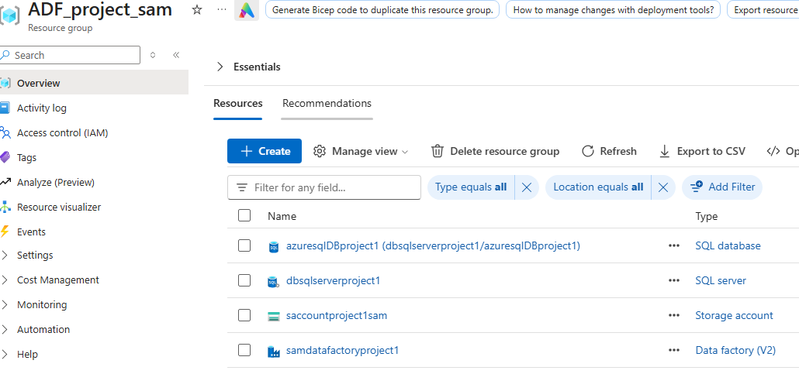</td>
  </tr>
</table>

**Linked services:** `AzureSql` (Azure SQL Database), `FileServer1` (file system, via the self-hosted IR), `LS_github` (HTTP), `LSdatalake` (ADLS Gen2).

<table>
  <tr>
    <th align="center">Linked Services</th>
  </tr>
  <tr>
    <td align="center">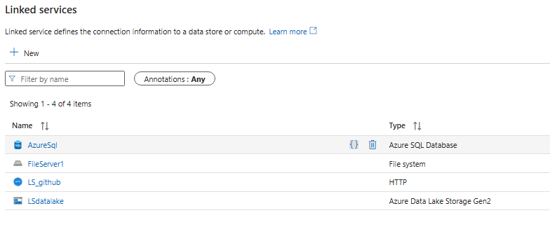</td>
  </tr>
</table>

## Pipelines

### Bronze: raw ingestion

| Pipeline | What it does |
|---|---|
| `Onprem_Ingestion` | A `ForEach` iterates over the files in the local folder and runs a parameterized copy into `bronze/Onprem`. The file list is driven by parameters, so adding files needs no pipeline change. |
| `API_Ingestion` | A `Web` activity issues a GET against the GitHub raw URL, then `Copy_Api_Data` lands the file in `bronze/github` through an HTTP dataset (base URL = domain, relative URL = path). |
| `Azuresql_to_datalake` | Incremental load of `FactBookings` into `bronze/sql` (see below). |
| `parentPipeline` | Runs the three pipelines above in sequence with `Execute Pipeline` activities. |

<table>
  <tr>
    <th align="center">Onprem Ingestion</th>
    <th align="center">API_Ingestion</th>
    <th align="center">Azuresql_to_datalake</th>
    <th align="center">parentPipeline</th>
  </tr>
  <tr>
    <td align="center">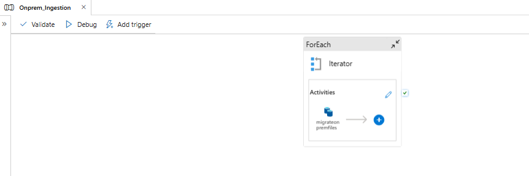</td>
    <td align="center">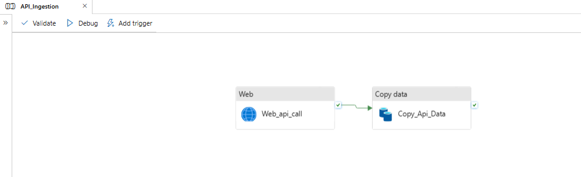</td>
    <td align="center">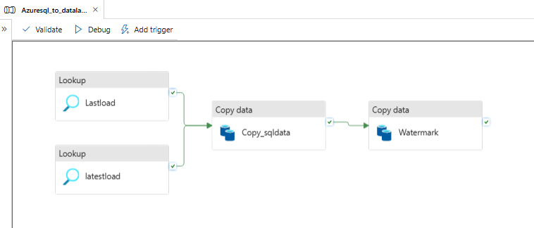</td>
    <td align="center">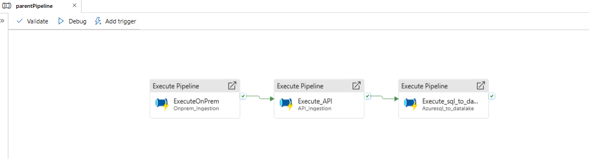</td>
  </tr>
</table>

### Incremental ingestion

<table>
  <tr>
    <th align="center">Incremental Ingestion</th>
  </tr>
  <tr>
    <td align="center"></td>
  </tr>
</table>

1. A `Lookup` (`Lastload`) reads the previous watermark from `monitor/lastload.json`.
2. A second `Lookup` (`latestload`) finds the newest date currently in the table:
   ```sql
   select max(booking_date) as latestload from dbo.FactBookings
   ```
3. `Copy_sqldata` copies only the rows between the two values:
   ```sql
   select * from dbo.FactBookings
   where booking_date > '@{activity('Lastload').output.firstRow.lastload}'
   and booking_date <= '@{activity('latestload').output.firstRow.latestload}'
   ```
4. A final `Copy` activity (`Watermark`) writes `latestload` back to `lastload.json`, so the next run starts where this one ended.

**How it was proven.** The first batch loaded `booking_id` 1 to 499, and the pipeline ran. Then new rows dated in July were inserted, and the pipeline ran again: only the new rows were copied and `lastload` moved to the July date.


### Silver: cleaning and conformance

Pipeline `Silver_Layer` runs the **`datatransformation`** data flow.

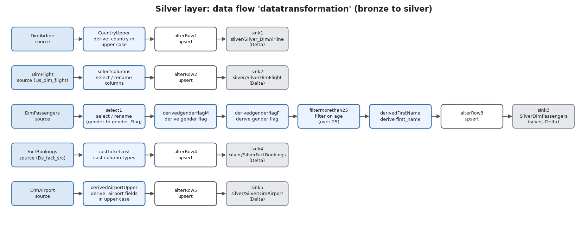

| Stream | Transformations |
|---|---|
| DimAirline | uppercase `country` |
| DimFlight | select / rename columns |
| DimPassengers | rename `gender` to `gender_Flag`, derive M/F flags, keep passengers over 25, derive `first_name` |
| FactBookings | cast `ticket_cost` and other columns to proper types |
| DimAirport | uppercase airport fields |

Every stream passes through an **alter row** step with an upsert condition before it is written to a **Delta** sink, so reruns update existing rows instead of duplicating them.

<table>
  <tr>
    <th align="center">Silver Transformation</th>
  </tr>
  <tr>
    <td align="center">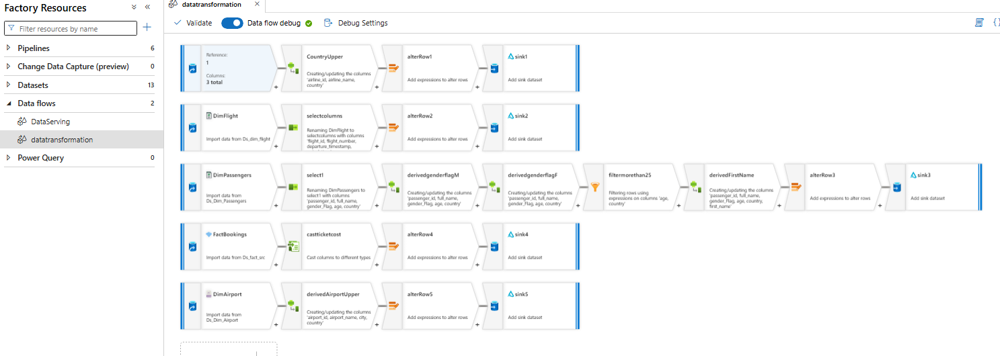</td>
  </tr>
</table>

### Gold: business views

Pipeline `Gold_Layer` runs the **`DataServing`** data flow. It builds two star-schema style views by left-joining `FactBookings` to a dimension, aggregating `totalSales`, ranking with a window transformation, and keeping the top results.


| Output folder | Question it answers |
|---|---|
| `gold/businessViewAirline` | Which airlines generate the most sales? |
| `gold/businessviewFlight` | Which flights generate the most sales? |

<table>
  <tr>
    <th align="center">Gold Layer</th>
  </tr>
  <tr>
    <td align="center">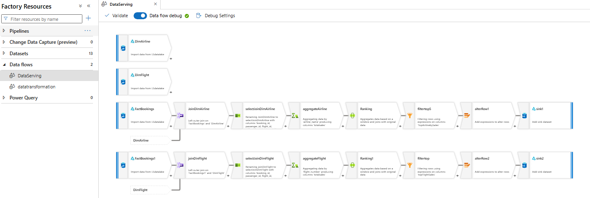</td>
  </tr>
</table>

## Run history

The monitor view shows the full set of runs from development, including two failed attempts of the SQL pipeline that were debugged and fixed. Final successful runs:

| Pipeline | Duration |
|---|---|
| `parentPipeline` (Onprem, API, SQL in sequence) | 2m 15s |
| `Silver_Layer` | 1m 35s |
| `Gold_Layer` | 3m 21s |
| `Azuresql_to_datalake` (incremental) | about 1m |

<table>
  <tr>
    <th align="center">Monitor log runs</th>
  </tr>
  <tr>
    <td align="center">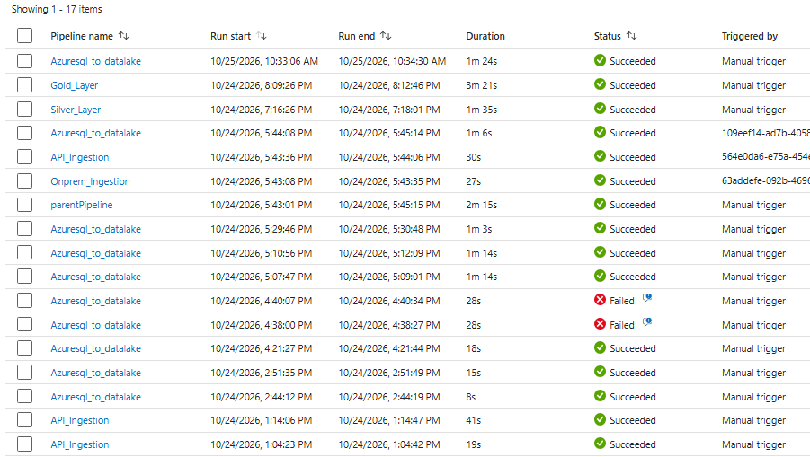</td>
  </tr>
</table>

## Repository layout

```
.
├── README.md
├── adf/                      # ADF JSON exports
├── data/source/              # sample dimension files (3 CSV + 1 JSON)
├── docs/
│   ├── design_notes.md       # concepts and design decisions
│   ├── diagrams/             # draw.io files
│   ├── images/               # PNG exports of the diagrams
│   └── screenshots/          # ADF / Azure portal screenshots
└── sql/
    └── fact_bookings_full.sql
```

## More screenshots

<table>
  <tr>
    <th align="center">Pipeline datasets</th>
    <th align="center">Self hosting local</th>
  </tr>
  <tr>
    <td align="center">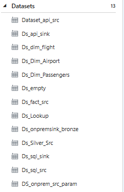</td>
    <td align="center">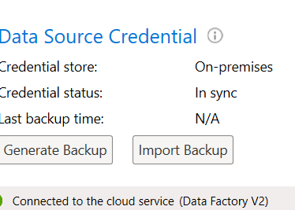</td>
  </tr>
</table>

## How to reproduce

1. Create a resource group, a storage account with **hierarchical namespace enabled** (ADLS Gen2), a SQL server and database, and a Data Factory (V2).
2. Create the containers `bronze`, `silver`, `gold`, and `monitor`. In `monitor`, add an `emptyjson` folder holding an empty `{}` JSON file and a `lastload` folder holding `lastload.json` seeded with a date earlier than every `booking_date`, so the first run loads everything.
3. In the Azure SQL query editor, run [`sql/fact_bookings_batch1.sql`](sql/fact_bookings_batch1.sql), then run `Azuresql_to_datalake`. Next run [`sql/fact_bookings_batch2.sql`](sql/fact_bookings_batch2.sql) and run the pipeline again. The second run should copy only the new rows.
4. Install the **self-hosted integration runtime** on the machine that holds the source folder, register it with the factory, and grant it access to that folder.
5. Create the linked services and datasets listed above, then build the pipelines and data flows (or import them from `adf/`).
6. Run `parentPipeline`, then `Silver_Layer`, then `Gold_Layer`. Keep data flow debug sessions short, since cluster time is billed.

## Design decisions and lessons learned

- **Linked service vs integration runtime.** The linked service defines the connection; the integration runtime is the compute that makes the activity possible. Reaching an on-prem machine requires the self-hosted runtime.
- **Parameterized datasets over hard-coding.** File names come from parameters, so the pipeline scales as files are added.
- **Watermark kept in the lake.** A small JSON file in a `monitor` container keeps state without needing a control table.
- **Upsert before the sink.** Alter row with an upsert condition makes data flows safe to rerun.
- **Cost awareness.** Data flow debug clusters bill while on, so they are enabled only when needed.

More detail in [`docs/design_notes.md`](docs/design_notes.md).

## Next steps

- Make the watermark finer-grained. `booking_date` is a `DATE`, so rows that arrive later with a date equal to the current watermark would be missed. A load timestamp or an ever-increasing key would be safer.
- Add a **schedule trigger** on `parentPipeline`. Runs here were triggered manually, which was enough to prove the incremental logic.
- Chain `Silver_Layer` and `Gold_Layer` into the parent pipeline.
- Move secrets to **Azure Key Vault**.
- Add CI/CD through ADF Git integration and ARM templates.
- Connect the gold views to Power BI.
